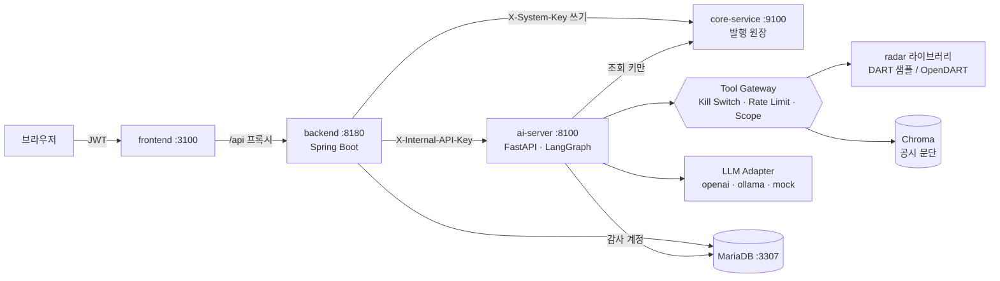

# 공시레이더 — 공시 비교·검증 멀티 에이전트 시스템

DART 정기보고서 두 건(전년 같은 보고서와 당기 보고서)을 비교해 **바뀐 문단**을 찾고, 수치 변화가 큰 계정마다
**회사가 공시 본문에서 밝힌 서술**을 원문 인용과 함께 연결한 뒤, **코드 검증 → 사람 검토 → 발행 승인(HITL)**으로 넘기는 시스템입니다.

금융 풀스택 과정의 Quant-X(금융 리서치 멀티 에이전트) 아키텍처를 공시 도메인으로 옮겼습니다 — 강의 실습 프로젝트
"나만의 도메인 AI 에이전트 시스템"에 해당합니다. 권한(Scope)·감사 로그·가드레일·Kill Switch·폐쇄망 LLM 전환까지
통제가 코드와 DB 권한으로 강제되고, **AI는 조회와 초안까지만 하며 발행은 사람이 승인해야 Core Zone에 기록**됩니다.

> 샘플 데이터의 회사(샘플소재㈜, 피어기업01~29)·인물·수치는 모두 **가상**입니다. 원문 XML에는 실제 DART 원문에서 알려진
> 함정(감사보고서 동봉, 이스케이프 안 된 `&`, TE/TU 셀, cp949인데 utf-8 선언, 가짜 태그)과 레드팀용 인젝션 문단을 일부러 넣었습니다.

## 시스템 구성

| 층 | 디렉터리 | 구성 | 포트 |
|---|---|---|---|
| DMZ | `frontend/` | React 18 + TypeScript + Vite + TanStack Query + Tailwind (`/api` 프록시) | 3100 |
| Service Layer | `backend/` | Spring Boot 3 · Java 21 — JWT 인증, 분석 요청, 리포트 검토, 발행 결재(HITL), 감사·관리 API | 8180 |
| AI Layer | `ai-server/` | FastAPI · LangChain · LangGraph — Manager-Worker 에이전트, Tool Gateway, RAG(Chroma), 가드레일, LLM 전환 | 8100 |
| 도메인 라이브러리 | `ai-server/radar/` | 공시 파서·문단 정렬·수치·관련 서술·코드 검증·사업 지표·지배구조·TTM/PER/PBR | — |
| Core Zone | `core-service/` | FastAPI + SQLite — **리포트 발행 원장**(조회 키/시스템 키 분리, 멱등성, 상태 머신) | 9100 |
| Local LLM | Ollama | `qwen2.5:7b`, 임베딩 `bge-m3` (폐쇄망 모드) | 11434 |
| DB | Docker `gongsi-mariadb` | MariaDB 11, DB `gongsi` | 3307 |

브라우저는 Spring Boot(`/api`)만 부릅니다. FastAPI·Core는 내부 키를 가진 서버끼리만 부릅니다.
계층 간 경로·필드·키는 [`docs/CONTRACT.md`](docs/CONTRACT.md)가 정본입니다.



### 에이전트 (Manager-Worker, LangGraph)

```
plan(Manager) → disclosure_analyst → financial_analyst → risk_reviewer ─통과→ report_writer → Output Filter
                                          ↑                    │
                                          └──코드 검증 반려(최대 2회)┘
```

| Worker | 결정적 단계(코드) | 서술 단계(LLM, Tool 사용) |
|---|---|---|
| `disclosure_analyst` | 수집·파싱 → 수치 분석 → 본문 비교, 원문 RAG 색인 | `compare_filings`, `search_disclosures` |
| `financial_analyst` | 관련 서술 연결(반려된 계정만 다시) | `get_financial_changes`, `get_business_metrics`, `get_valuation`, `get_stock_price` |
| `risk_reviewer` | 코드 검증(인용 ID·금액·증감률·방향·근거 수준·소송 교차 확인), 규정 검사 | `get_governance`, `get_lawsuits` |
| `report_writer` | 리포트 계약 JSON(`docs/report.schema.json`) | 검증된 사실만으로 본문 작성 |

**숫자와 근거는 결정적 단계에서만 나옵니다.** LLM이 쓴 메모·본문은 재료일 뿐이고, 최종 본문과 모든 요약·관련 서술은
Output Filter(투자 권유·가치판단·보장·단정 표현)를 다시 통과해야 나갑니다. 모든 데이터 접근은 Tool Gateway를 거쳐
`agent_tool_call_log`에, 모든 LLM 호출은 `llm_invocation_log`에 남습니다(프롬프트는 해시만).

### HITL — 리포트 발행

```
DRAFT ─발행 요청─→ PENDING ─Senior 승인─→ PUBLISHED ─(정정 발행 승인)→ SUPERSEDED
   ↑                 │
   └──── 반려 ←───────┘ (REJECTED, 수정 후 재요청)        PENDING ─24시간─→ EXPIRED
```
- 발행 요청 시점의 리포트 본문 SHA-256을 Core에 남기고, 승인 때 같은 해시를 보내야 PUBLISHED가 됩니다(요청 뒤 수정 차단).
- 자기 요청은 승인할 수 없습니다(Spring·Core 이중 검사). AI 서버에는 쓰기 Tool도 시스템 키도 없습니다.

## 알파인더 참고 기능

| 기능 | 어디서 |
|---|---|
| 계산식·출처 펼치기 — 모든 증감률·플래그·TTM·PER·PBR에 계산식, 입력값, 출처(접수번호·필드·연결/별도) | `radar/formula.py`, 화면의 "계산식" |
| 사업 지표 추출·검산 — 부문 매출·수주·생산능력·가동률을 구조가 명확한 표에서만 규칙 추출, 산술 검산 통과분만 사용 | `radar/business.py` |
| 기업 목록·검색·상세 — 매출·영업이익률·시가총액·PER·PBR, 재무·시장·지배구조·공시 목록 | `radar/company.py`, `/companies` |
| 지배구조·관계망 — 최대주주·임원·타법인출자 변동과 관계 그래프(목록에 있는 회사는 링크) | `radar/governance.py` |
| TTM·PER·PBR — 최근 연간 + 당해 누적 − 전년 누적, 지배주주 계정(없으면 대체 계정 표시), 이익 ≤ 0이면 계산 안 함 | `radar/valuation.py` |

## 실행

사전 준비: Docker, Java 21, Node 20+, Python 3.10+ (macOS 기본 `python3`는 3.9라 안 됩니다 — Homebrew 등으로 설치).

```bash
scripts/db.sh up                                   # MariaDB 컨테이너(3307) + 스키마·시드 적용

# 최초 1회: 각 서버 의존성
(cd core-service && python3.14 -m venv .venv && .venv/bin/pip install -r requirements.txt && cp .env.example .env)
(cd ai-server && python3.14 -m venv .venv && .venv/bin/pip install -r requirements.txt && cp .env.example .env)
(cd frontend && npm install)

scripts/dev.sh start                               # core → ai → backend → frontend 순서로 기동, 로그는 .tmp/logs/
open http://localhost:3100                          # analyst_001(Junior) · senior_001(Senior), 비밀번호 password
scripts/dev.sh stop
```

시연 흐름: `analyst_001`로 로그인 → 새 분석(999001, 2025, 사업보고서, "시연용 오류 주입" 체크) → 에이전트 타임라인에서
반려·재연결 확인 → 리포트 검토·문구 수정 → 발행 요청 → `senior_001`로 로그인 → 결재함에서 승인 → 발행 원장·감사 추적 확인.

### 폐쇄망 모드

`ai-server/.env`에서 `LLM_PROVIDER=ollama`, `EMBEDDING_PROVIDER=ollama`, `ALLOW_EXTERNAL_LLM=false`.
외부 provider는 목록에 `blocked`로 남고 고를 수 없습니다(전환 API 403). 관리 화면에서 런타임 전환도 됩니다(재기동하면 `.env` 값).

### 실데이터

`RADAR_SOURCE=opendart OPENDART_API_KEY=…`(OpenDART), 시세는 `DATA_GO_KR_API_KEY`(공공데이터포털 금융위원회_주식시세정보).
응답은 `ai-server/.cache/`에 캐시합니다. 12월 결산 법인만 지원하고, 은행·보험·증권은 손익 구조가 달라 결과를 신뢰하기 어렵습니다.

### 도메인 라이브러리만 쓰기

```bash
cd ai-server
.venv/bin/python -m radar demo --fault         # 샘플 분석 → out/report.json
.venv/bin/python -m radar companies 샘플          # 기업 검색
.venv/bin/python -m radar parse 원문.zip --blocks  # DART 원문 파싱 통계
```

## DB 스키마와 계정

| 파일 | 내용 |
|---|---|
| `scripts/sql/01_schema.sql`, `seed.sql` | 사용자·권한·분석 요청·리포트 |
| `02_agent_schema.sql` | Worker 실행 이력 |
| `03_hitl_schema.sql` | 발행 결재 큐 |
| `04_governance_schema.sql` | 감사 3종·Kill Switch·`gongsi_audit`/`gongsi_app` 계정 |
| `05_llm_schema.sql` | LLM 호출 기록 |
| `06_rag_schema.sql` | RAG 문서·청크 메타(벡터는 Chroma) |

| 계정 | 쓰는 곳 | 권한 |
|---|---|---|
| root | DDL 적용(사람) | 전부 |
| `gongsi_app` | Spring·FastAPI 런타임 | 업무 테이블 읽기·쓰기, 감사 테이블 읽기만, DELETE 없음 |
| `gongsi_audit` | 감사 기록 전용 커넥션 | 감사 테이블 INSERT·SELECT만(append-only, `prev_hash` 해시 체인) |

## 테스트

```bash
(cd ai-server && .venv/bin/python -m pytest)           # radar 라이브러리 + AI 서버(외부 서비스 없이, 기록은 인메모리)
(cd core-service && .venv/bin/python -m pytest)        # 임시 SQLite
(cd backend && ./gradlew test)
(cd frontend && npm run build)                         # 타입 검사 포함
(cd ai-server && .venv/bin/python redteam/run.py)      # AI 서버 기동 후 가드레일 Red Team
```

## 주의

- 교육·시연용입니다. 투자 판단이나 매매 권유에 쓰지 않습니다. 리포트는 반드시 DART 원문과 대조하세요.
- 감사 로그는 append-only입니다. 원문·PII는 저장하지 않고 해시와 마스킹 결과만 남깁니다.
- 규칙 기반 가드레일은 우회될 수 있습니다(예: 숫자를 끊어 쓴 주민번호). Scope·키 분리·사람 결재가 함께 막습니다.
