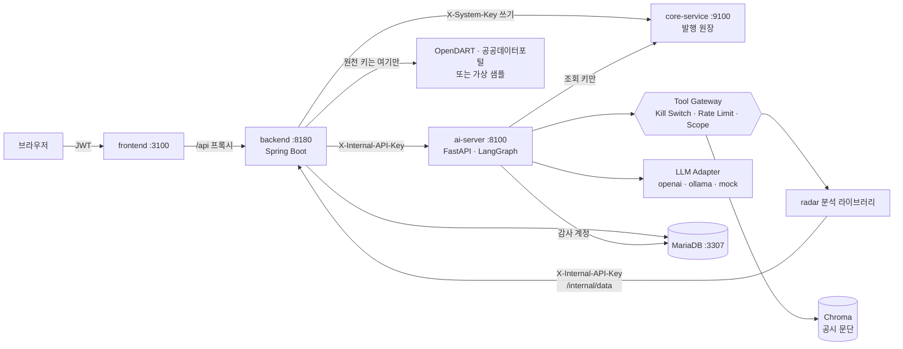

# 공시레이더 — 공시 비교·검증 멀티 에이전트 시스템

DART 정기보고서 두 건(전년 같은 보고서와 당기 보고서)을 비교해 **바뀐 문단**을 찾고, 수치 변화가 큰 계정마다
**회사가 공시 본문에서 밝힌 서술**을 원문 인용과 함께 연결한 뒤, **코드 검증 → 사람 검토 → 발행 승인(HITL)**으로 넘기는 시스템입니다.

금융 풀스택 과정의 Quant-X(금융 리서치 멀티 에이전트) 아키텍처를 공시 도메인으로 옮겼습니다 — 강의 실습 프로젝트
"나만의 도메인 AI 에이전트 시스템"에 해당합니다. 권한(Scope)·감사 로그·가드레일·Kill Switch·폐쇄망 LLM 전환까지
통제가 코드와 DB 권한으로 강제되고, **AI는 조회와 초안까지만 하며 발행은 사람이 승인해야 Core Zone에 기록**됩니다.

> 샘플 데이터의 회사(샘플소재㈜, 피어기업01~29)·인물·수치는 모두 **가상**입니다. 원문 XML에는 실제 DART 원문에서 알려진
> 함정(감사보고서 동봉, 이스케이프 안 된 `&`, TE/TU 셀, cp949인데 utf-8 선언, 가짜 태그)과 레드팀용 인젝션 문단을 일부러 넣었습니다.

## 시스템 구성

| 층 | 디렉터리 | 구성 | 포트 |
|---|---|---|---|
| DMZ | `frontend/` | React 18 + TypeScript + Vite + TanStack Query + Tailwind (`/api` 프록시) | 3100 |
| Service Layer (데이터·업무) | `backend/` | Spring Boot 3 · Java 21 — JWT 인증, 분석 요청, 리포트 검토, 발행 결재(HITL), 감사·관리 API, **OpenDART·공공데이터포털 연동과 일일 수집**, 기업·시장 화면 데이터 계산, AI 서버용 내부 데이터 API | 8180 |
| AI Layer (AI·문서 분석) | `ai-server/` | FastAPI · LangChain · LangGraph — Manager-Worker 에이전트, Tool Gateway, RAG(Chroma), 가드레일, LLM 전환. **원천 키 없음** — 데이터는 Spring 내부 API로만 받는다 | 8100 |
| 분석 라이브러리 | `ai-server/radar/` | 공시 파서·문단 정렬·수치·관련 서술·코드 검증·사업 지표·지배구조 변동·TTM/PER/PBR(리포트용) | — |
| Core Zone | `core-service/` | FastAPI + SQLite — **리포트 발행 원장**(조회 키/시스템 키 분리, 멱등성, 상태 머신) | 9100 |
| Local LLM | Ollama | `qwen2.5:7b`, 임베딩 `bge-m3` (폐쇄망 모드) | 11434 |
| DB | Docker `gongsi-mariadb` | MariaDB 11, DB `gongsi` | 3307 |

브라우저는 Spring Boot(`/api`)만 부릅니다. FastAPI·Core는 내부 키를 가진 서버끼리만 부릅니다.
역할 경계(docs/CONTRACT.md §11): **Spring = 데이터·업무**(원천 연동·수집·화면 데이터·인증·결재·감사), **FastAPI = AI·문서 분석**(에이전트·공시 비교·검증·RAG·가드레일·LLM).
계층 간 경로·필드·키는 [`docs/CONTRACT.md`](docs/CONTRACT.md)가 정본입니다.



### 에이전트 (Manager-Worker, LangGraph)

```
plan(Manager) → disclosure_analyst → financial_analyst → risk_reviewer ─통과→ report_writer → Output Filter
                                          ↑                    │
                                          └──코드 검증 반려(최대 2회)┘
```

| Worker | 결정적 단계(코드) | 서술 단계(LLM, Tool 사용) |
|---|---|---|
| `disclosure_analyst` | 수집·파싱 → 수치 분석 → 본문 비교, 원문 RAG 색인 | `compare_filings`, `search_disclosures` |
| `financial_analyst` | 관련 서술 연결(반려된 계정만 다시) | `get_financial_changes`, `get_business_metrics`, `get_valuation`, `get_stock_price` |
| `risk_reviewer` | 코드 검증(인용 ID·금액·증감률·방향·근거 수준·소송 교차 확인), 규정 검사 | `get_governance`, `get_lawsuits` |
| `report_writer` | 리포트 계약 JSON(`docs/report.schema.json`) | 검증된 사실만으로 본문 작성 |

**숫자와 근거는 결정적 단계에서만 나옵니다.** LLM이 쓴 메모·본문은 재료일 뿐이고, 최종 본문과 모든 요약·관련 서술은
Output Filter(투자 권유·가치판단·보장·단정 표현)를 다시 통과해야 나갑니다. 모든 데이터 접근은 Tool Gateway를 거쳐
`agent_tool_call_log`에, 모든 LLM 호출은 `llm_invocation_log`에 남습니다(프롬프트는 해시만).

### HITL — 리포트 발행

```
DRAFT ─발행 요청─→ PENDING ─Senior 승인─→ PUBLISHED ─(정정 발행 승인)→ SUPERSEDED
   ↑                 │
   └──── 반려 ←───────┘ (REJECTED, 수정 후 재요청)        PENDING ─24시간─→ EXPIRED
```
- 발행 요청 시점의 리포트 본문 SHA-256을 Core에 남기고, 승인 때 같은 해시를 보내야 PUBLISHED가 됩니다(요청 뒤 수정 차단).
- 자기 요청은 승인할 수 없습니다(Spring·Core 이중 검사). AI 서버에는 쓰기 Tool도 시스템 키도 없습니다.

## 알파인더 참고 기능

| 기능 | 어디서 |
|---|---|
| 계산식·출처 펼치기 — 모든 증감률·플래그·TTM·PER·PBR에 계산식, 입력값, 출처(접수번호·필드·연결/별도) | Spring `finance/Formulas`(화면 데이터)·Python `radar/numbers/formula.py`(리포트), 화면의 "계산식" |
| 사업 지표 추출·검산 — 부문 매출·수주·생산능력·가동률을 구조가 명확한 표에서만 규칙 추출, 산술 검산 통과분만 사용 | AI `radar/insights/business.py`(원문 표 분석) |
| 기업 목록·검색·상세 — 매출·영업이익률·시가총액·PER·PBR, 재무·시장·지배구조·공시 목록 | Spring `company/CompanyService`, `/companies` |
| 지배구조·관계망 — 최대주주·임원·타법인출자 변동과 관계 그래프(목록에 있는 회사는 링크) | AI `radar/insights/governance.py` |
| TTM·PER·PBR — 최근 연간 + 당해 누적 − 전년 누적, 지배주주 계정(없으면 대체 계정 표시), 이익 ≤ 0이면 계산 안 함 | Spring `finance/Valuations`(화면)·Python `radar/numbers/valuation.py`(리포트) — 같은 결과를 골든 테스트로 고정 |
| 시장 화면 — 지수 추이(공식 지수 키가 없으면 '대체 지수'로 표시), 시가총액 추이, KSIC 업종 지도(트리맵·드릴다운), 최근 정기보고서 | Spring `market/MarketOverviewService`, `/market` |

## 폴더 구조

```
gongsi-radar/
├─ frontend/            React(Vite) — pages/ 화면, components/ 화면 조각, api/ 호출·타입
├─ backend/             Spring Boot — com.gongsiradar.<도메인>/
│                         controller/  REST 컨트롤러
│                         service/     업무 로직
│                         repository/  JPA 엔티티·enum·Repository(도메인별 한 폴더)
│                         dto/         요청·응답
│                         client/ config/ security/ ... 도메인에 필요한 것만
│                       finance/ 계산식·TTM·PER·PBR, data/ 원천 소스(OpenDART·샘플·적재 DB), ingest/ 일일 수집
├─ ai-server/           FastAPI
│  ├─ app/              api/ 라우터, agents/ graph/ LangGraph, llm/ rag/ safety/ 가드레일,
│  │                    tools/ Tool Gateway·Tool, infra/ DB 엔진·Core 클라이언트, services/ schemas/
│  ├─ radar/            분석 라이브러리(서버와 무관)
│  │                    parsing/ 원문 파싱·표, diff/ 문단 정렬·분류·임베딩, numbers/ 재무·계산식·밸류에이션,
│  │                    evidence/ 관련 서술·코드 검증, insights/ 사업 지표·지배구조, pipeline/ 그래프·리포트 스키마,
│  │                    sources/ 데이터 소스(base·sample·service), cli.py config.py llm.py
│  └─ tests/            radar/ 라이브러리 테스트, app/ 서버 테스트
├─ core-service/        FastAPI + SQLite — 리포트 발행 원장(Core Zone)
├─ db/                  schema/01~07 DDL·계정, seed.sql
├─ scripts/             db.sh(MariaDB) · dev.sh(전체 기동·종료)
├─ samples/             가상 샘플 데이터(두 서버가 같이 씀)
└─ docs/                FEATURES.md(기능 정리) · CONTRACT.md(서비스 간 계약) · report.schema.json
```

## 실행 방법

### 1. 준비물

| 도구 | 버전 | 확인 명령 | 비고 |
|---|---|---|---|
| Docker | 최근 버전 | `docker info` | MariaDB 컨테이너만 띄운다(앱 서버는 로컬 프로세스) |
| Java | 21 | `java -version` | 백엔드. Gradle은 `gradlew`가 처음 실행 때 내려받는다 |
| Node.js | 20 이상 | `node -v` | 프런트 |
| Python | 3.10 이상(3.12~3.14 확인) | `python3.12 --version` 등 | **macOS 기본 `python3`는 3.9라 안 된다.** `brew install python@3.12`로 설치 |
| Ollama | 선택 | `ollama list` | 폐쇄망 모드에서만. `ollama pull qwen2.5:7b`, `ollama pull bge-m3` |

아래 명령의 `python3.12`는 설치한 3.10+ 실행 파일로 바꿔 쓴다(예: `python3.14`, `/opt/homebrew/opt/python@3.14/bin/python3.14`).

### 2. 처음 한 번 — 설치

저장소 루트에서 차례로 실행한다.

```bash
git clone git@github.com:ShinhanDSProject/gongsi-radar.git
cd gongsi-radar

# DB: MariaDB 컨테이너(gongsi-mariadb, 포트 3307) 기동 + 스키마·계정·시드 적용
scripts/db.sh up

# Core Zone(발행 원장)
(cd core-service && python3.12 -m venv .venv && .venv/bin/pip install -r requirements-dev.txt && cp .env.example .env)

# AI 서버(+ radar 라이브러리)
(cd ai-server && python3.12 -m venv .venv && .venv/bin/pip install -r requirements.txt && cp .env.example .env)

# 프런트
(cd frontend && npm install)

# 백엔드는 설치가 따로 없다(처음 기동할 때 gradlew가 Gradle·의존성을 내려받아 1~3분 걸린다)
```

`.env`는 커밋하지 않는다. 기본값만으로 샘플 데이터·mock LLM 모드가 바로 돈다(외부 키 불필요).

### 3. 기동과 종료

```bash
scripts/dev.sh start     # core(9100) → ai(8100) → backend(8180) → frontend(3100) 순서로 띄운다
scripts/dev.sh status    # 포트별 기동 여부
scripts/dev.sh stop      # 전부 내린다(gradle이 띄운 JVM까지)
scripts/db.sh down       # MariaDB 컨테이너 정지(데이터는 남는다. 다음엔 scripts/db.sh up)
```

- 브라우저: **http://localhost:3100**
- 로그는 `.tmp/logs/{core-service,ai-server,backend,frontend}.log`. 이미 떠 있는 포트는 건너뛴다.
- 서버를 하나씩 띄우고 싶으면(같은 순서로 터미널 4개):

  ```bash
  cd core-service && .venv/bin/uvicorn app.main:app --port 9100
  cd ai-server    && .venv/bin/uvicorn app.main:app --port 8100
  cd backend      && ./gradlew bootRun
  cd frontend     && npm run dev
  ```

### 4. 로그인과 시연 흐름

| 계정 | 비밀번호 | 역할 | 볼 수 있는 메뉴 |
|---|---|---|---|
| `analyst_001`, `analyst_002` | `password` | Junior 애널리스트 | 분석 · 기업 · 시장 · 발행 원장 |
| `senior_001` | `password` | Senior 매니저 | 위 + 결재함 · 관리 |

1. `analyst_001`로 로그인 → **분석** → 새 분석: 회사 `999001`, 2025, 사업보고서, "시연용 오류 주입" 체크 → 분석 시작
2. 에이전트 타임라인에서 Risk Reviewer가 영업이익 문장을 **반려 → 재연결 → 통과**하는 것을 본다(1~2초, mock LLM)
3. 리포트 탭(변경 문단·수치·사업 지표·지배구조·시장 지표)을 검토하고 요약 문구를 고친다 — "저평가" 같은 표현은 저장이 막힌다
4. **발행 요청** → 이후 수정은 잠긴다
5. `senior_001`로 로그인 → **결재함**에서 승인 → 결재란에 도장, **발행 원장**에 PUBLISHED(v1). 자기가 요청한 건은 승인할 수 없다
6. **관리** → 감사 로그에서 요청 UID로 추적, Kill Switch를 켜면 새 분석이 막힌다
7. **기업**·**시장** 메뉴에서 기업 목록·업종 지도·시가총액 추이를 본다(샘플 46개사, 모두 가상)

같은 회사·기간을 다시 승인하면 정정 발행(v2)으로 처리되고 v1은 SUPERSEDED가 된다.

### 5. 설정 바꾸기

**데이터(Spring, 백엔드 환경변수)** — `backend/src/main/resources/application.yaml` 기본값을 환경변수로 덮어쓴다.

| 하고 싶은 것 | 설정 | 비고 |
|---|---|---|
| 실제 공시(OpenDART) | `GONGSI_DATA_SOURCE=opendart`, `OPENDART_API_KEY=…` | https://opendart.fss.or.kr 에서 무료 발급. 응답은 `backend/.cache/`에 캐시 |
| 실제 시세·지수 | `DATA_GO_KR_API_KEY=…`(디코딩 키) | 공공데이터포털 금융위원회_주식시세정보·지수시세정보. 없으면 PER·PBR은 "계산 안 함", 지수는 '대체 지수' |
| 업종 피어(robust z) | `GONGSI_PEERS_FILE=피어고유번호.json` | 다중회사 주요계정 API, 100개사씩 |
| 일일 수집 예약 | `GONGSI_INGEST_CRON="0 30 18 * * MON-FRI"` | 기본 꺼짐. 아래 7번 |

그 밖에 `AI_SERVER_API_KEY`, `DATA_API_KEY`(AI 서버 → Spring 내부 데이터 API), `CORE_SYSTEM_KEY`, `JWT_SECRET`, `MARIADB_*` 등. 운영에서는 개발용 기본 키를 반드시 바꾼다.

**AI(`ai-server/.env`)** — 원천 API 키는 두지 않는다.

| 하고 싶은 것 | 설정 | 비고 |
|---|---|---|
| OpenAI로 서술 생성 | `LLM_PROVIDER=openai`, `OPENAI_API_KEY=…` | 관리 화면에서 런타임 전환도 된다(재기동하면 `.env` 값) |
| 폐쇄망 모드 | `LLM_PROVIDER=ollama`, `EMBEDDING_PROVIDER=ollama`, `ALLOW_EXTERNAL_LLM=false` | `ollama serve` 필요. 외부 provider는 목록에 `blocked`로 남는다. 분석 1건 약 7분 |
| 데이터 받는 곳 | `RADAR_SOURCE=service`, `RADAR_SERVICE_URL`, `RADAR_SERVICE_KEY` | 기본값 그대로 쓴다(Spring 내부 데이터 API). 데이터가 가상 샘플이면 리포트에 '가상 기업 샘플'로 표시된다 |

실데이터 경로(OpenDART·공공데이터포털)는 응답 문서에 맞춰 구현했지만 실키로는 아직 검증하지 않았다(#1). 12월 결산 법인만 지원하고,
은행·보험·증권은 손익 구조가 달라 결과를 신뢰하기 어렵다. 키는 환경변수·`.env`에만 두고 커밋하지 않는다.

### 6. 문제가 생기면

| 증상 | 원인·해결 |
|---|---|
| `TypeError: unsupported operand type(s) for \|` 등 문법 오류 | Python 3.9로 venv를 만들었다. `.venv`를 지우고 3.10+로 다시 만든다 |
| `dev.sh start`에서 포트가 뜨지 않음 | `.tmp/logs/<서버>.log`를 본다. 다른 프로그램이 3100·8100·8180·9100을 쓰고 있으면 `lsof -nP -iTCP:<포트> -sTCP:LISTEN` |
| 백엔드가 `Schema-validation` 오류로 죽음 | DB 스키마가 적용되지 않았다. `scripts/db.sh apply` |
| 로그인은 되는데 분석 실행이 503 `AI_SERVER_UNAVAILABLE` | AI 서버가 꺼져 있다(`scripts/dev.sh status`) |
| 분석이 `KILL_SWITCH_ACTIVE` | 관리 화면에서 Kill Switch가 켜져 있다 |
| 발행 요청이 409 | Core가 거절한 사유가 화면에 나온다(같은 리포트의 대기 건, 하루 한도 등) |
| MariaDB를 처음부터 다시 | `docker rm -f gongsi-mariadb && scripts/db.sh up` (감사 로그 등 모든 데이터가 지워진다) |

### 7. 일일 수집(전 종목 적재)

기업 목록·시장 화면·업종 지도를 전 종목으로 보려면 하루 한 번 수집을 돌린다. 수집은 Spring이 수집 전용 DB 계정(`gongsi_ingest`)으로 한다.
화면에서 시작하는 버튼은 없다.

```bash
cd backend
./gradlew bootRun --args='--gongsi.ingest.run-once=daily'      # 상장사·최근 공시·시세·지수·재무·업종·원문 증분(웹 서버 없이 돌고 끝남)
./gradlew bootRun --args='--gongsi.ingest.run-once=backfill'   # 회사별 지난 정기공시·재무(여러 날에 걸쳐 이어서)
GONGSI_INGEST_CRON="0 30 18 * * MON-FRI" ./gradlew bootRun     # 서버를 띄우면서 예약 실행
```

- 같은 날 두 번 돌려도 결과가 같고(upsert), 호출 예산(`INGEST_DAILY_BUDGET`, 기본 15,000)이 떨어지면 다음 실행이 이어서 처리한다.
- Kill Switch가 켜져 있으면 수집도 멈춘다. 실행마다 감사 로그에 `INGEST_RUN`이 남는다.
- 화면 데이터는 적재 DB를 먼저 읽고, 비어 있으면 원천(샘플·OpenDART)을 쓴다.
- 관리 화면 "데이터 수집"에서 마지막 수집 시각·단계별 결과·남은 호출 예산을 본다.

### 8. 분석 라이브러리만 쓰기

서버 없이 `radar` 분석 라이브러리만 샘플로 돌릴 수 있다(기업 목록·시장 화면·수집은 Spring 몫이라 여기에는 없다).

```bash
cd ai-server
.venv/bin/python -m radar demo --fault           # 샘플 분석 → out/report.json
.venv/bin/python -m radar parse 원문.zip --blocks  # DART 원문 파싱 통계
```

## DB 스키마와 계정

| 파일 | 내용 |
|---|---|
| `db/schema/01_schema.sql`, `db/seed.sql` | 사용자·권한·분석 요청·리포트 |
| `02_agent_schema.sql` | Worker 실행 이력 |
| `03_hitl_schema.sql` | 발행 결재 큐 |
| `04_governance_schema.sql` | 감사 3종·Kill Switch·`gongsi_audit`/`gongsi_app` 계정 |
| `05_llm_schema.sql` | LLM 호출 기록 |
| `06_rag_schema.sql` | RAG 문서·청크 메타(벡터는 Chroma) |
| `07_ingest_schema.sql` | 일일 수집 적재 테이블·`gongsi_ingest` 계정 |

| 계정 | 쓰는 곳 | 권한 |
|---|---|---|
| root | DDL 적용(사람) | 전부 |
| `gongsi_app` | Spring·FastAPI 런타임 | 업무 테이블 읽기·쓰기, 감사 테이블 읽기만, DELETE 없음 |
| `gongsi_audit` | 감사 기록 전용 커넥션 | 감사 테이블 INSERT·SELECT만(append-only, `prev_hash` 해시 체인) |
| `gongsi_ingest` | Spring 일일 수집(전용 커넥션) | 적재 테이블 SELECT·INSERT·UPDATE만(DELETE 없음) |

## 테스트

```bash
(cd ai-server && .venv/bin/python -m pytest)           # radar 라이브러리 + AI 서버(외부 서비스 없이, 기록은 인메모리)
(cd core-service && .venv/bin/python -m pytest)        # 임시 SQLite
(cd backend && ./gradlew test)
(cd frontend && npm run build)                         # 타입 검사 포함
(cd ai-server && .venv/bin/python redteam/run.py)      # AI 서버 기동 후 가드레일 Red Team
```

## 주의

- 교육·시연용입니다. 투자 판단이나 매매 권유에 쓰지 않습니다. 리포트는 반드시 DART 원문과 대조하세요.
- 감사 로그는 append-only입니다. 원문·PII는 저장하지 않고 해시와 마스킹 결과만 남깁니다.
- 규칙 기반 가드레일은 우회될 수 있습니다(예: 숫자를 끊어 쓴 주민번호). Scope·키 분리·사람 결재가 함께 막습니다.
