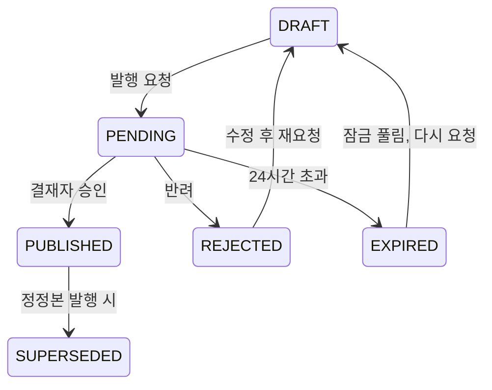

# 공시레이더 기능 정리

기준일 2026-10-19. 실행 방법은 [README](../README.md), 서비스 간 계약은 [CONTRACT.md](CONTRACT.md)에 있다.

## 개요

공시레이더는 같은 회사의 정기보고서 두 건(예: 전년 사업보고서와 올해 사업보고서)을 비교해 무엇이 바뀌었는지 찾고, 그 내용을 근거와 함께 검증한 리포트로 만드는 시스템이다. 애널리스트가 작성하고 결재자가 승인한 리포트만 발행된다.

세 가지 원칙으로 움직인다.

- **숫자는 코드가 계산한다**: 증감률·TTM·PER·PBR 같은 숫자는 LLM이 아니라 코드가 계산하고, 계산식과 입력값, 출처(접수번호·계정·연결/별도)를 펼쳐 보여준다.
- **모든 문장에 근거가 있다**: LLM이 쓴 문장도 원문 문단을 인용해야 하고, 코드 검증을 통과해야 리포트에 남는다.
- **판단은 사람이 한다**: 매수·매도·목표가 같은 투자 권유 표현은 출력 필터가 막고, 발행은 사람의 결재를 거친다.

| 구성 요소 | 기술 | 포트 | 맡은 일 |
| --- | --- | --- | --- |
| 프런트 | React(Vite) | 3100 | 분석·리포트·결재·기업·시장·관리자 화면 |
| 백엔드 | Spring Boot 3.3, Java 21 | 8180 | 인증·권한, 분석 요청, 리포트 수정·결재, 원천 데이터 연동, 일일 수집, 기업·시장 화면 데이터 |
| AI 서버 | FastAPI, LangGraph | 8100 | 멀티 에이전트 분석, LLM·RAG, 가드레일, 원문 분석(사업 지표·지배구조) |
| Core | FastAPI, SQLite | 9100 | 리포트 발행 원장(발행된 리포트의 정본) |
| DB | MariaDB 11 | 3307 | 업무·감사·수집 데이터 |
| LLM | Ollama(qwen2.5:7b, bge-m3) 또는 OpenAI 호환 API | 11434 | 문장 생성·임베딩(폐쇄망에서는 로컬 모델만) |

역할 분리: 데이터와 업무는 Spring이, AI와 문서 분석은 FastAPI가 맡는다. AI 서버는 OpenDART 같은 원천 API 키를 갖지 않고 Spring의 내부 데이터 API로만 데이터를 받는다.

## 공시 비교·분석

회사와 사업연도·보고서 종류를 고르면, 직전 같은 종류 보고서와 비교한 리포트가 나온다. 분석은 여섯 단계를 차례로 거친다.

1. **수집(ingest)**: 두 보고서의 DART 원문 zip을 받아 장·절·문단·표 단위로 파싱한다. 인코딩이 깨진 원문은 복구하고, 본문 파일을 골라낸다.
2. **수치(numbers)**: 재무 API로 주요 계정 증감을 계산한다. 매출 대비 변동액 1% 이상이면서 증감률 30% 이상인 계정에 표시를 달고, 동종업체 대비 도드라진 변동(robust z 3 이상)도 표시한다.
3. **비교(diff)**: 두 보고서의 문단을 임베딩과 문자열 유사도로 짝짓고 바뀐 부분을 찾는다. 표는 행 단위로 따로 비교한다.
4. **관련 서술 연결(relate)**: 숫자가 크게 바뀐 계정마다 그 이유를 설명하는 원문 문장을 찾아 붙인다. 예: 매출 감소와 "판매단가 하락" 문단.
5. **검증(verify)**: 변동 항목과 연결 문장을 코드로 하나씩 검사한다. 통과 못 한 항목은 고쳐 쓰고 다시 검사하며, 최대 2번까지 반복한다.
6. **리포트(report)**: 검증 결과를 모아 리포트 JSON을 만들고 스키마 검사를 한다.

변동 항목은 종류와 주제로 분류하고, 두 값을 곱한 중요도 순으로 보여준다.

| 구분 | 값 |
| --- | --- |
| 변동 종류 | 신설, 삭제, 표현 수정, 수치 수정 |
| 주제 | 위험·소송, 사업·시장, 거래, 기타 |
| 검증 결과 | 통과, 재작성 후 통과, 반려 |

코드 검증은 다음 항목을 확인한다.

- 인용 ID 존재, 근거 수준 재확인
- 요약 수치 대조, 본문 수치 대조, 금액 대조(재무 API)
- 증감률 재계산, 증감 방향
- 주요사항보고서 교차 확인(예: 소송 금액)
- 문서 인젝션, 출력 필터, 2단 판정

리포트는 화면에서 개요, 변동 항목, 수치, 표 비교, 사업 지표, 지배구조, 시장 지표, 파싱 통계, 실행 이력 탭으로 나눠 보여준다. 각 문장에서 원문 문단과 DART 원문 링크로 바로 이동할 수 있다.

## 멀티 에이전트·LLM·RAG

분석 요청은 LangGraph로 엮은 Manager-Worker 구조의 에이전트들이 처리한다. 각 Worker는 정해진 Tool만 쓸 수 있고, 모든 호출은 Tool Gateway를 거쳐 기록된다.

1. **계획(plan)**: 요청을 보고 어떤 Worker가 무엇을 볼지 정한다.
2. **공시 분석가(disclosure_analyst)**: 본문 비교, 사업 지표, 지배구조, 소송 공시를 본다.
3. **재무 분석가(financial_analyst)**: 계정 증감과 관련 서술, TTM·PER·PBR, 시세를 본다.
4. **위험 검토자(risk_reviewer)**: 초안을 규정 위반 후보와 근거 기준으로 검토한다. 통과하지 못하면 수정을 요청하고, 최대 2번까지 다시 검토한다.
5. **리포트 작성(report_writer)**: 최종 리포트를 쓰고, 출력 필터를 통과한 결과만 내보낸다.

에이전트가 쓸 수 있는 Tool은 다음과 같다. 필요한 권한(scope)이 없는 사용자의 요청에서는 호출이 막힌다.

| Tool | 필요 권한 | 내용 |
| --- | --- | --- |
| compare_filings | DISCLOSURE_READ | 전년 대비 정기보고서 본문 비교 |
| get_financial_changes | DISCLOSURE_READ | 계정 증감과 관련 서술 연결 결과 |
| get_business_metrics | DISCLOSURE_READ | 부문 매출·수주·생산능력·가동률(검산 통과분) |
| get_governance | DISCLOSURE_READ | 주주·임원·타법인출자 변동 |
| get_lawsuits | DISCLOSURE_READ | 주요사항보고서(소송 등 제기) |
| get_document_insights | DISCLOSURE_READ | 기업 상세용 원문 파생 정보 |
| get_valuation | MARKET_DATA_READ | TTM·PER·PBR(계산식·출처 포함) |
| get_stock_price | MARKET_DATA_READ | 최근 N영업일 종가·시가총액 |
| search_disclosures | RAG_READ | 공시 원문 문단 검색 |
| check_compliance_rules | REPORT_READ | 리포트 초안의 규정 위반 후보 검사 |
| get_publication_history | PUBLICATION_READ | 발행 원장 이력 조회 |

**LLM 어댑터**: openai(OpenAI 호환 API), ollama(로컬 모델), mock(테스트용) 중에서 고른다. 관리자 화면에서 운영 중에 바꿀 수 있고, 폐쇄망 설정을 켜면 외부 API 호출이 막힌다. 응답이 정해진 JSON 형식을 어기면 다시 요청하고, 그래도 안 되면 규칙 기반 결과로 대신한다. 호출마다 모델·토큰·지연 시간을 기록한다.

**RAG**: 파서가 나눈 문단 하나가 청크 하나이고, 청크 ID가 곧 인용 ID다. 벡터는 Chroma에, 메타데이터는 MariaDB에 저장한다. 임베딩은 bge-m3(Ollama), OpenAI, 테스트용 해시 방식 중에서 고른다.

## 가드레일·안전장치

LLM에 들어가는 입력과 나가는 출력, 에이전트의 Tool 호출을 각각 따로 막고 기록한다. 막힌 사례는 모두 가드레일 이벤트로 남아 관리자 화면에서 볼 수 있다.

| 장치 | 하는 일 |
| --- | --- |
| 입력 필터 | 사용자 질문의 개인정보를 지운 뒤(복원 불가), 프롬프트 인젝션 패턴을 탐지해 막는다. |
| 출력 필터 | 매수·매도·목표가·저평가·수익 보장·추천·상승 전망 같은 투자 권유·가치판단 표현을 찾아 고쳐 쓰거나 막는다. 화면에서도 같은 목록으로 먼저 막고 서버가 다시 검사한다. |
| 문서 인젝션 격리 | 원문에 심어진 지시문(간접 프롬프트 인젝션)을 "지시문 의심"으로 표시하고 따르지 않는다. 인용 근거에서 빼고, RAG에서는 신뢰도 LOW로 두어 기본 검색에서 제외한다. |
| RAG 신뢰도 | HIGH(DART 원문), MEDIUM(원문 안의 외부 추정치 인용), LOW(지시문 의심) |
| Tool Gateway | 모든 Tool 호출을 Kill Switch → 호출 한도 → 권한(scope) 순서로 검사하고, 호출마다 기록을 남긴다. |
| 호출 한도 | 사용자별 Tool 호출을 1분에 120번으로 제한한다. 인젝션에 걸린 에이전트가 같은 호출을 반복하는 것을 막기 위한 것이다. |
| Kill Switch | 켜면 새 분석과 Tool 호출이 모두 멈춘다. 상태를 덮어쓰지 않고 토글할 때마다 이력을 쌓는다. |
| 감사 로그 | 추가만 가능한 전용 계정으로 쓰고, 각 행이 이전 행의 해시를 담아(해시 체인) 중간 수정이나 삭제를 바로 알 수 있다. |
| 폐쇄망 모드 | 외부 LLM·Moderation API 호출을 막고 로컬 모델만 쓴다. |

레드팀 프롬프트 모음(`ai-server/redteam/`)으로 인젝션·투자 권유 유도 사례를 돌려 필터가 막는지 테스트한다.

## 리포트 검토·발행(HITL)

분석이 끝난 리포트는 초안일 뿐이고, 결재자(SENIOR_MANAGER)가 승인해야 Core 발행 원장에 기록된다.

발행 요청 이후에는 본문을 고칠 수 없고, 승인 시점의 내용 해시가 요청 시점과 같아야 발행된다.

- **수정**: 애널리스트는 초안의 변동 요약과 관련 서술 문장을 고칠 수 있다. 고친 문장도 출력 필터를 다시 통과해야 하고, 고친 항목에는 "검토자 수정" 표시가 붙는다.
- **승인 규칙**: 결재자만 승인할 수 있고, 자기가 요청한 리포트는 승인할 수 없다. 주니어 애널리스트의 승인 시도는 거부(403)된다.
- **정정 발행**: 이미 발행한 리포트를 고치려면 새 버전을 발행한다. 승인되면 이전 발행본은 대체됨(SUPERSEDED)이 되고 원장에는 두 버전이 모두 남는다.
- **Core 발행 원장**: 발행된 리포트의 정본이다. 발행·승인은 Spring만 할 수 있고(시스템 키), AI 서버는 이력을 읽기만 한다.
- **기록**: 요청·수정·승인·반려가 모두 감사 로그에 남고, 화면의 검토 패널에서 이력을 볼 수 있다.

## 기업·시장 화면

분석 리포트 외에도 기업을 찾아보고 시장 전체를 훑어볼 수 있는 화면이 있다. 화면 데이터는 Spring이 계산하고, 원문을 읽어야 하는 부분(사업 지표·지배구조)만 AI 서버가 만든다.

| 화면 | 내용 |
| --- | --- |
| 기업 목록 | 회사명·종목코드로 검색, 상장사 목록 |
| 기업 상세 · 재무 | 주요 계정 증감과 표시(중요 변동·동종업체 대비 이상치), 정기보고서 목록과 바로 분석 요청 |
| 기업 상세 · 사업 | 부문 매출·수주·생산능력·가동률. 구조가 분명한 표에서만 규칙으로 뽑고, 합계 검산을 통과한 값만 보여줌 |
| 기업 상세 · 시장 지표 | 시가총액, TTM 순이익, PER, PBR. 이익이 0 이하면 계산하지 않고 이유를 표시 |
| 기업 상세 · 지배구조 | 최대주주·임원·타법인출자 변동과 관계 그래프. 목록에 있는 회사는 링크로 이동 |
| 시장 · 지수 추이 | 지수 그래프와 기간별 등락률 |
| 시장 · 시가총액 추이 | 상장사 시가총액 합계 추이 |
| 시장 · 업종 지도 | KSIC 업종별 트리맵(면적 = 시가총액) |
| 시장 · 최근 정기보고서 | 새로 나온 정기보고서와 분석 가능 여부, 새로 확인한 기업 |

**계산식 펼치기**: 화면의 모든 증감률·표시·TTM·PER·PBR을 누르면 계산식, 입력값, 출처(접수번호·필드·연결/별도)가 펼쳐진다. TTM은 최근 연간 실적 + 당해 누적 − 전년 동기 누적으로 구하고, 지배주주 계정을 우선 쓰며 없으면 대체 계정을 표시한다. Spring(화면)과 Python(리포트)의 계산 결과가 같도록 골든 테스트로 고정해 두었다.

샘플 데이터로 돌 때는 화면과 리포트에 "샘플 데이터" 표시가 붙는다.

## 데이터 연동·일일 수집

원천 데이터는 OpenDART(공시·재무·지배구조)와 공공데이터포털(시세·지수)이고, 연동은 모두 Spring이 맡는다. 데이터 소스는 설정으로 고른다.

| 소스 | 쓰는 경우 |
| --- | --- |
| 샘플(sample) | 기본값. 저장소의 가상 기업 데이터(`samples/data`). 키 없이 전 구간 시연·테스트 |
| OpenDART(opendart) | 실제 공시. 백엔드 환경변수에 API 키가 필요 |
| 적재 DB(ingested) | 일일 수집으로 MariaDB에 쌓아 둔 데이터 |

**일일 수집**은 전 종목의 기업·공시·재무·시세를 적재 DB에 쌓는다. 예약 실행(cron)과 1회 실행을 모두 지원한다. 단계는 우선순위 순이고, 호출 예산이 모자라면 뒤 단계부터 다음 날로 밀린다.

1. **companies**: 상장사 목록. 신규 상장과 상장폐지를 표시한다(행을 지우지 않음).
2. **filings**: 최근 정기공시. 평소엔 새로 나온 것만, backfill은 회사별 3년치를 받는다.
3. **market**: 날짜별 전 종목 시세. 저장된 마지막 날짜 이후만 받는다.
4. **index**: 지수 일별 종가.
5. **financials**: 새로 접수된 보고서의 재무. 같은 접수번호는 다시 부르지 않는다.
6. **induty**: 업종 코드. 시가총액 큰 회사부터, 확인한 지 90일 지난 것만 받는다.
7. **documents**: 최근 90일 정기공시 원문 ZIP.

- **호출 예산**: 실행당 15,000건(OpenDART 하루 20,000건 한도 안). 단계 중간에도 실시간으로 세어 넘지 않게 한다.
- **멱등성**: 모든 쓰기는 upsert여서 같은 날 두 번 돌려도 결과가 같다.
- **전용 계정**: 수집은 SELECT·INSERT·UPDATE만 가능한 `gongsi_ingest` 계정으로 쓴다. 앱 계정은 적재 테이블을 읽기만 한다.
- **실행 기록**: 단계별 결과(성공·부분·실패, 호출 수)를 남기고 관리자 화면에서 볼 수 있다.

**내부 데이터 API**(`/internal/data/**`): AI 서버가 데이터를 받는 유일한 창구다. 회사 검색, 공시 목록, 보고서, 원문, 재무, 동종업체, 소송, 지배구조, 시세를 원천 응답 모양 그대로 돌려준다. 내부 키로 인증하고, 응답 헤더(`X-Data-Origin`)로 샘플인지 실데이터인지 알려준다.

## 계정·권한·관리자 화면

로그인은 JWT 방식(만료 시 갱신 토큰으로 재발급)이고, 역할과 권한(scope)에 따라 쓸 수 있는 기능과 Tool이 달라진다.

| 시드 계정 | 역할 | 권한 |
| --- | --- | --- |
| analyst_001, analyst_002 | JUNIOR_ANALYST | DISCLOSURE_READ, MARKET_DATA_READ, RAG_READ, REPORT_READ |
| senior_001 | SENIOR_MANAGER | 위 4개 + REPORT_WRITE, PUBLICATION_READ |

개발용 계정의 비밀번호는 모두 `password`다. 주니어는 분석 요청·초안 수정·발행 요청까지, 결재자는 승인·반려와 발행 이력 조회까지 할 수 있다.

DB 계정도 나눠 두었다.

| DB 계정 | 쓰는 곳 | 권한 |
| --- | --- | --- |
| gongsi_app | Spring·FastAPI 런타임 | 업무 테이블 읽기·쓰기, 감사 테이블은 읽기만, DELETE 없음 |
| gongsi_audit | 감사 기록 | 감사 테이블 INSERT·SELECT만 |
| gongsi_ingest | 일일 수집 | 적재 테이블 SELECT·INSERT·UPDATE만 |

**관리자 화면**에서 할 수 있는 일은 다음과 같다.

- **Kill Switch**: 켜고 끄기와 토글 이력(누가, 언제, 왜)
- **LLM 공급자**: openai·ollama·mock 전환과 최근 LLM 호출 기록
- **가드레일 이벤트**: 막힌 입력·출력을 심각도별로 조회
- **감사 로그**: 요청 ID 단위로 분석·수정·결재 기록 추적
- **수집 현황**: 단계별 결과, 사용한 호출 수, 수동 실행

모든 요청에는 요청 ID(`X-Request-ID`)가 붙어 프런트, Spring, AI 서버, Core를 거치는 동안 같은 ID로 추적된다.

## 품질·운영

네 계층 테스트가 모두 통과한 상태이고, 외부 서비스 없이 샘플 데이터와 mock LLM으로 돌아간다. 아래 숫자는 2026-10-15 폴더 구조 정리 때 확인한 것이다.

| 대상 | 테스트 | 내용 |
| --- | --- | --- |
| AI 서버 | 101개 | radar 라이브러리(파서·정렬·검증·밸류에이션), API·에이전트 그래프·가드레일·레드팀 |
| Core | 21개 | 발행·승인·정정·만료, 해시 일치 |
| 백엔드 | 56개 | 인증, 결재 워크플로, 감사, 수집(H2), 내부 데이터 API, 골든 테스트 |
| 프런트 | 빌드 | 타입 검사(단위 테스트는 아직 없음) |

**골든 테스트**: 계산식·TTM·PER·PBR을 Spring으로 옮기면서, Python 결과를 정답 파일로 저장해 Java 결과와 비교한다. 두 언어의 계산이 어긋나면 테스트가 실패한다.

**실행**: `scripts/db.sh up`으로 MariaDB를 띄우고 스키마·시드를 적용한 뒤, `scripts/dev.sh start`로 네 서버를 한 번에 띄운다. 자세한 방법은 README의 실행 방법에 있다.

**남은 과제**

- [ ] #1 OpenDART 실제 키로 전 구간 점검(지금은 샘플 데이터로만 검증)
- [ ] #2 OpenDART 추가 API: 재무지표 대조, 지분공시, 주요사항보고서
- [ ] CI(GitHub Actions)로 push·PR마다 테스트와 비밀값 검사 자동 실행
- [ ] docker-compose로 한 줄 실행, 백엔드 `.env.example` 추가
- [ ] 프런트 단위 테스트(Vitest)와 시연 흐름 E2E(Playwright)
- [ ] 호출 한도 카운터를 프로세스 밖(Redis 등)으로 옮기기. 지금은 AI 서버를 두 대로 늘리면 한도가 두 배가 된다.
